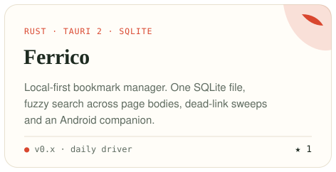
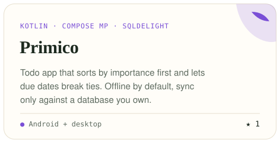
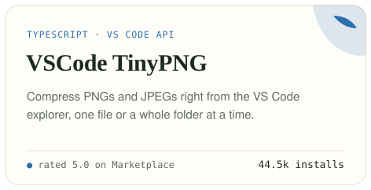
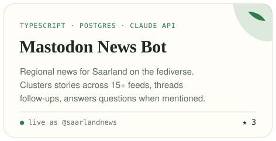

<a href="https://andi1984.dev">
  <picture>
    <source media="(prefers-color-scheme: dark)" srcset="assets/banner-dark.svg">
    
  </picture>
</a>

I've been building for the web since 2012. Right now that means [Dimensions](https://www.dimensions.ai) at Digital Science: React and TypeScript at the core, Python and FastAPI behind them, and more and more LLM features that have to be useful in practice, not only in a demo. My favourite parts of the job are the ones that stay hard: naming things, deleting things, and making slow pages fast.

  <a href="https://andi1984.dev"><b>andi1984.dev</b></a> &nbsp;·&nbsp;
  <a href="https://andi1984.dev/writing">Writing</a> &nbsp;·&nbsp;
  <a href="https://andi1984.github.io/CV/">CV</a> &nbsp;·&nbsp;
  <a href="https://www.linkedin.com/in/andi1984">LinkedIn</a> &nbsp;·&nbsp;
  <a href="https://dibbelabb.es/@andi1984dev" rel="me">Mastodon</a> &nbsp;·&nbsp;
  <a href="https://dev.to/andi1984">dev.to</a> &nbsp;·&nbsp;
  <a href="https://www.youtube.com/@andi1984dev">YouTube</a>

### Right now

- 🛠️ **Building** an Android build of Ferrico and smarter duplicate detection
- 🦀 **Learning** enough Rust to stop fighting the borrow checker in public
- 🍅 **Growing** tomatoes, three kinds of mint and one stubborn fig tree
  <!-- ACTIVITY:START -->
- 🌱 **Recently pushed** to [primico](https://github.com/viberfasend/primico), [andi1984-api](https://github.com/andi1984/andi1984-api) and [ferrico_dot_app](https://github.com/viberfasend/ferrico_dot_app)
  <!-- ACTIVITY:END -->

### Things I've built

Most of my newer side projects live in **[viberfasend](https://github.com/viberfasend)**. I build them with a coding agent in the loop, but they still get tests, CI and docs. They're local-first by habit, and I build them because I need them myself.

  <a href="https://github.com/viberfasend/ferrico_dot_app"><picture><source media="(prefers-color-scheme: dark)" srcset="assets/cards/ferrico-dark.svg"></picture></a>
  <a href="https://github.com/viberfasend/primico"><picture><source media="(prefers-color-scheme: dark)" srcset="assets/cards/primico-dark.svg"></picture></a>
  <a href="https://github.com/andi1984/vscode-tinypng"><picture><source media="(prefers-color-scheme: dark)" srcset="assets/cards/tinypng-dark.svg"></picture></a>
  <a href="https://github.com/andi1984/mastodon-news-bot"><picture><source media="(prefers-color-scheme: dark)" srcset="assets/cards/newsbot-dark.svg"></picture></a>

<b>Smaller things</b>

 

- **[Kann ich lüften?](https://viberfasend.github.io/kann-ich-lueften/)** compares the absolute humidity inside and outside and tells you whether opening the window dries your flat or makes it damper. It's an offline PWA, in German.
- **[fastapi-queuepool-demo](https://github.com/andi1984/fastapi-queuepool-demo)** reproduces SQLAlchemy's "QueuePool limit reached" error. It goes with [this post](https://andi1984.dev/posts/python/fastapi-queuepool-limit).
- **[claude-marketplace](https://github.com/andi1984/claude-marketplace)** holds my Claude Code plugins, with skills for Rust desktop apps, Supabase and Love2D.
- **[back2roots](https://github.com/andi1984/back2roots)** is the Twig + Markdown static site generator I wrote before static site generators became a whole thing.

### Latest writing

<!-- WRITING:START -->
- **[CSS Quantity Queries, Nine Years Later: :has() and sibling-count()](https://andi1984.dev/posts/css/quantity-queries-nine-years-later)** Oct 24, 2026 · article · css
- **[I Built an API About Myself - and My Website Now Reads From It](https://andi1984.dev/posts/developer-tools/my-own-personal-api)** Oct 19, 2026 · article · python, developer tools
- **[My two repos had a chat. I mostly watched.](https://andi1984.dev/notes/ai/agents-talking-to-agents)** Oct 9, 2026 · note · ai, claude-code
- **[QueuePool Limit Reached - When FastAPI Runs Out of Database Connections](https://andi1984.dev/posts/python/fastapi-queuepool-limit)** Oct 5, 2026 · article · python · <a href="https://dev.to/andi1984/queuepool-limit-reached-when-fastapi-runs-out-of-database-connections-2c2f">also on dev.to</a>
- **[Ferrico - Taking My Bookmarks Back Home with Tauri and Rust](https://andi1984.dev/posts/ferrico)** Jun 14, 2026 · article · developer tools · <a href="https://dev.to/andi1984/ferrico-taking-my-bookmarks-back-home-with-tauri-and-rust-524e">also on dev.to</a>
<!-- WRITING:END -->

More at <a href="https://andi1984.dev/writing">andi1984.dev/writing</a> · <a href="https://andi1984.dev/rss.xml">RSS</a>

### Tools I reach for

<picture>
  <source media="(prefers-color-scheme: dark)" srcset="https://skillicons.dev/icons?i=ts%2Creact%2Cvue%2Ccss%2Cpython%2Cfastapi%2Crust%2Ctauri%2Ckotlin%2Cgo%2Cpostgres%2Cneovim%2Clinux&theme=dark">
  
</picture>

  

<picture>
  <source media="(prefers-color-scheme: dark)" srcset="https://raw.githubusercontent.com/andi1984/andi1984/output/snake-dark.svg">
  
</picture>

This README rebuilds itself every few hours from my blog, dev.to and the GitHub API (<a href="scripts/build.py">scripts/build.py</a>).
